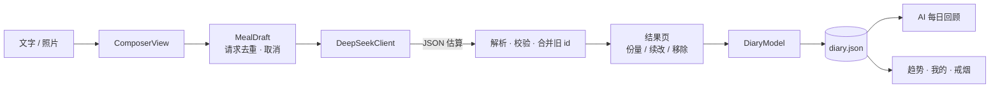

# 小食痰记 · Xiaoshitanji

<p align="center">
  
</p>

<p align="center">
  <b>用一句话、一张照片，记下你吃了什么。</b><br/>
  一个记录饮食、抽烟与身体的私人 iPhone 应用，AI 负责估算，你只负责吃。
</p>

<p align="center">
  
  
  
  
  
  
</p>

<p align="center">
  
  
  
  
  
</p>

> 名字取自《小石潭记》的谐音：**小食**是吃，**痰**是烟。一个 app，把「今天吃了什么、抽了几根、身体怎么样」都记下来。

---

## 目录

- [这是什么](#这是什么)
- [功能](#功能)
- [快速开始](#快速开始)
- [技术栈](#技术栈)
- [架构](#架构)
- [AI 是怎么工作的](#ai-是怎么工作的)
- [数据与隐私](#数据与隐私)
- [测试](#测试)
- [构建与签名](#构建与签名)
- [项目状态与路线图](#项目状态与路线图)
- [设计文档](#设计文档)
- [免责声明](#免责声明)
- [许可](#许可)

---

## 这是什么

「小食痰记」是一个**自用**的 iPhone 应用：你描述刚刚吃了什么（文字、相册照片或直接拍照），它调用 DeepSeek 估算食物条目、份量、热量与三大营养素，保存成一条餐次记录；每天结束时，它根据已保存的餐食生成一段 AI 回顾，并在 7/30 天趋势里展示摄入与评分变化。

除此之外，它还顺手管了两件事：

- **戒烟**：烟包库存、抽一根/分烟/余量校准、尼古丁与花费的按日汇总，烟盒也能拍照识别；
- **身体**：昵称、头像、身高、体重、BMI，以及只读的 Apple 健康数据（步数、活动能量、锻炼、距离、体重、身高）。

它不联网同步、没有账号体系、不接第三方统计，所有记录就是本地一个 JSON 文件。

| 维度 | 说明 |
| --- | --- |
| 平台 | iPhone，竖屏，iOS 26+ |
| 语言 | 简体中文界面 |
| 视觉 | 浅色黄色主题 + 原生 Liquid Glass，奶蛙吉祥物 |
| 依赖 | 零第三方依赖，仅系统框架 |
| 网络 | 仅在你点击分析时直连 `api.deepseek.com` |

---

## 功能

### 记一餐：输入 → 估算 → 修正 → 保存

- 支持**文字**、**相册照片**、**拍照**三种输入，文字可以补充图片（例如「这碗只吃了一半」）。
- 三种识别模式：**自动**（默认）、**碗装餐食**（结合碗型、装满程度、汤水与剩余量）、**营养标签**（见下一节）。
- 估算结果是可解释的：结果页会给出食物列表、自然份量、估算依据（summary）、假设（assumptions）与所用模型。
- 修正方式有四种，全部记录进 `adjustments` 以便回看：
  - 份量倍率：0.5× / 0.75× / 1.5× / 2×；
  - 自然语言续改：「米饭只吃了一半」「还有一碗汤」——AI 在现有餐食上增量修正，未提到的食物保持原样、原 id 回传；
  - 手改营养值：点进任一食物直接改写热量与三大营养素，标记为「手动填写」，不再依赖 AI；
  - 单项移除。
- 不依赖 AI 的记录方式：**手动填写**（名称、份量、克数、热量与蛋白质/碳水/脂肪，离线可用）与**一键复用**（把整餐存为「常吃组合」、搜索历史食物、复制最近吃过的一餐）。
- 保存到四餐次卡片（早/午/晚/加餐）。早餐默认 08:45、午餐 12:00、晚餐 20:00（取自个人常用时间范围的中间值），加餐取当前时刻；时间也可手动调整。
- 首页按本地日期汇总，可翻页、可开日历跳转；跨天或回到前台自动刷新到今天。
- 首页把「目标 − 已摄入」显示成**今日剩余**；目标优先由能量目标推导，没设置时退回通用设置里的参考热量。

### 营养标签

- 包装食品优先读营养表，保留原始计量基准：每 100 克 / 每 100 毫升 / 每份 / 每包。
- 能量单位支持 **kJ 与 kcal**，千焦按 `kJ ÷ 4.184` 换算成千卡，再按实际食用量等比缩放。
- 标签读取失败或看不清时不会瞎编：返回空标签并提示补拍，标签信息与份量估算在界面上分别标注。

### 每日 AI 回顾

- 「蛙的饮食碎碎念」：只依据**已保存**的餐食生成总结、最多 3 条亮点、最多 3 条建议，信息足够时给出 0–100 的参考评分。
- 少于 2 餐或信息不足时**不评分**（score 为 `null`），而不是硬凑一个分数。
- 修改、补记、删除当天餐食后，旧回顾自动失效；回顾会记录生成时的每日热量目标，目标变了就等待一份基于新目标的回顾，历史评分仍对应当时的目标。

### 趋势

- 最近 **7 天 / 30 天**切换：摄入柱状图（带均值参考线）、AI 评分折线、每日列表。
- 日均值只按**有记录的日子**计算，没有记录的那天是空缺而不是 0。

### 我的与 Apple 健康

- 顶部资料卡：头像、昵称、身高、当前体重、目标体重，自动算 BMI（身高需在 50–250 cm 之间才计算）。
- 体重历史：手动记录 + Apple 健康测量合并展示，取时间最新的一条，同一时间优先手动记录。
- Apple 健康**只读**：步数、活动能量、锻炼时长、步行跑步距离、体重、身高。授权后读取近 7 天活动趋势，保留无数据日期的空缺；读取失败时保留已有快照并给出提示。
- 能量目标：BMR（Mifflin-St Jeor）× 活动系数估算维持热量，再按减脂/维持/增肌推导每日目标与蛋白质/碳水/脂肪；记录 2–4 周后可用体重趋势校准维持热量。没设置时仍可只填一个参考热量（界面显示为「参考」而非硬性目标）。

### 戒烟记录

- 烟包管理：每包 20 根、记录开包时间与初始余量；「换一包」可从已识别保存的同款香烟里选择，也可切回未抽完的旧包，每包余量各自独立。
- 三类事件：**抽一根**（扣 1 根并记时间）、**分烟**（只扣库存）、**余量校准**（只修正库存）。事件可撤销，重放校验保证库存永远落在 0–20。
- 尼古丁按**每根标注值 × 自己抽的根数**累计（分烟不计入），未提供标注的单独显示「未知根数」。
- 花费按**每包价格 ÷ 20 × 根数**折算，CNY / VND / USD / HKD 分币种汇总，绝不跨币种相加。
- 烟盒 AI 识别：先拍正面读名称，再拍侧面读烟碱标注；只有照片能读到或你明确说出的价格与尼古丁才会采用，其余留空。可说「这包买了 30 元」「价格改成 25 元」补充，或「清空错误的尼古丁值」把它改回未知。

### 汇总分析

- 入口在「我的」资料卡下方的「汇总分析」，默认近 7 天，可切换近 30 天与全部记录；「全部」按月汇总。
- 一次综合四类数据：饮食摄入与营养分布、抽烟（自抽 / 分烟 / 尼古丁标注 / 费用）、身高体重 BMI 与测量变化、步数与活动能量。
- **发送前可预览**本地聚合出的数值，并选择是否包含 Apple 健康；确认后才请求 DeepSeek，缺失数据会明确标成「数据缺口」而不是编造。
- 报告包含综合观察、分类分析、优先行动与数据缺口，每个范围保留最近一份并随 JSON 导出；照片、头像、昵称与原始描述不会进入请求。

---

### 蛙的观察

- **自己找模式**：蛋白长期不足、抽烟集中在某个时段、记录断档、体重停滞、热量长期超标，全部在设备上算，开关可关；
- **自由追问**：问「晚饭怎么改」「为什么这周体重没动」，发送的是聚合数值（日期范围、餐数、日均营养、体重变化、步数与锻炼分钟），不包含照片、原始输入和昵称；
- **回答带依据**：每条回答写明引用的是哪个日期范围、多少餐、哪些测量；记录不够时 AI 被要求直接说明缺口，而不是编数字；
- **旧回答会被标注**：记录变化后，之前回答标记「基于旧数据」，可以随时删除。

### 云端同步

- **自己的服务器**：默认连 `https://xiaoshitanji.papaclaoud.top`（作者自建，域名可在界面里改成你自己的），FastAPI + PostgreSQL，密码用 Argon2id 存哈希，令牌存本机钥匙串；
- **整份快照**：登录后把整份日记作为一版快照上传，服务端保留最近 20 版，可列出、可恢复任意一版（恢复会合并进本机，不删本机独有记录）；
- **冲突自动合并**：上传带基线版本；云端有更新版本时先下载，按 id 取并集（本地重复项优先），合并后再上传，不会用旧数据覆盖新数据；
- **大小护栏**：单次快照上限 8 MB，超过会提示先清理内嵌照片；
- **密码与账号**：用户名 3–32 位小写字母/数字/`_`/`.`/`-`，密码 8–128 位；同一账号可登录多台设备，改密码会吊销其他设备的令牌。

### 训练记录

- **两类都记**：力量按动作记组数、次数、重量，自动算容量；有氧记项目、时长、距离和平均心率；
- **体感可选**：1–10 的体感强度与消耗热量都能留空，不强迫填；
- **不替代 Apple 健康**：这里只记训练本身，步数和活动热量仍从健康读；同一天可以记多次；
- **一处看全**：累计次数、总时长、力量容量和有氧公里数在「我的 → 训练记录」顶部。

### 每日提醒

- **四个提醒点**：早餐、午餐、晚餐、称重，时间自己调，逐个开关；
- **只在本机**：用系统的本地通知，不上传、不需要登录，关掉就真的不响；
- **首次开启才要权限**：没同意时静默跳过，不反复弹窗。

### 青蛙的坚持

- **连续天数**：今天或昨天有记录才算「还在连」，断一天就归零，最长记录同时保留；
- **累计成果**：累计餐数、记录天数、戒烟天数，一眼看到这段时间攒下了什么；
- **11 个里程碑**：第一餐、连记 3/7/30 天、30/100/365 餐、体重十次、第一个常吃、七天/三十天没点烟；
- **抽烟累计**：自己抽了多少根、分出去多少根、按烟包单价折算花了多少钱，全部从事件流累加，能一条条对回去；
- **不制造焦虑**：没解锁的徽章只写「还没解锁」，不催、不排名、不上传。

### 本机备份与导出

- **每天一份备份**：每天第一次打开 App 时把当前日记写到 `FoodDiary/Backups/diary-YYYY-MM-DD.json`，保留最近 14 份，可在通用设置里关掉；
- **CSV 导出**：餐次、体重、抽烟三张表一次导出（UTF-8、逗号转义、CRLF），直接丢进 Excel 或 Numbers；
- **JSON 导出**：整份日记原样导出，用于迁移或排查。

## 快速开始

### 环境

| 需要 | 版本 |
| --- | --- |
| Xcode | 26（含 iOS 26 SDK） |
| Swift | 6.0（语言模式），SwiftPM 6.2 |
| 测试环境 | macOS 15+（`swift test` 只跑纯逻辑，不需要模拟器） |
| 真机 | iOS 26 或更新，启用开发者模式 |

### 运行

1. 打开 `FoodDiary.xcodeproj`。
2. 选择 `FoodDiary` scheme。
3. 在 **Signing & Capabilities** 里换成你自己的开发团队（仓库里填的是作者团队，其他人直接跑会签名失败）。
4. 连接并解锁 iPhone，选择设备后运行。

命令行构建：

```sh
xcodebuild -project FoodDiary.xcodeproj -scheme FoodDiary \
  -configuration Debug -destination 'generic/platform=iOS' \
  -derivedDataPath work/DerivedData build
```

> `work/` 是本地构建与验证目录，已被 Git 忽略。

### 配置 API Key

首次使用需要自己的 DeepSeek API Key：

1. 「我的 → 通用设置」填入 Key，点「保存 API Key」；
2. Key 存进本机 Keychain（`kSecAttrAccessibleWhenUnlockedThisDeviceOnly`），不会写进记录文件，也不会随导出泄露；
3. 回到「饮食」点「扫描记一餐」，或直接点某个餐次开始记录。

调用使用官方地址 `https://api.deepseek.com/chat/completions`，模型 `deepseek-flash`，JSON Output、非流式、关闭思考模式，超时 90 秒。费用记在你自己的 API 账户上。

参考文档：

- [DeepSeek 首次调用](https://api-docs.deepseek.com/)
- [图片输入（vision）](https://api-docs.deepseek.com/guides/vision)
- [JSON Output](https://api-docs.deepseek.com/guides/json_mode)

### 跑测试

```sh
swift test
```

在 Mac 上直接运行，不需要模拟器，也不需要签名。

---

## 技术栈

| 层 | 选型 |
| --- | --- |
| 界面 | SwiftUI（iOS 26）、Liquid Glass、Observation（`@Observable`） |
| 数据 | `Codable` + JSON、`FileManager` 原子写入 |
| 密钥 | Security.framework / Keychain |
| AI | DeepSeek Chat Completions、JSON Output、vision |
| 健康 | HealthKit（只读） |
| 图像 | ImageIO（缩图 + 重编码）、UIImagePickerController |
| 测试 | Swift Testing（`swift-testing`） |

---

## 架构

```text
FoodDiary/                      SwiftUI 界面、Keychain、相机与图片处理
├── App/                        @main、Tab 容器、全局 DiaryModel 与视觉主题
├── Features/                   饮食 / 趋势 / 戒烟 / 我的 各页面与组件
├── Services/                   HealthKit 读取、照片处理、Keychain
└── Assets.xcassets/            奶蛙素材与餐次图标

FoodDiary.xcodeproj/            iPhone 原生工程（自动签名、HealthKit entitlement）
Sources/NutritionCore/          纯逻辑 Swift Package，无 UIKit 依赖
Tests/NutritionCoreTests/       103 个 Swift Testing 用例
docs/superpowers/               设计规格（specs）与实施计划（plans）
work/                           本地构建与验证记录（Git 忽略）
```

`NutritionCore` 是刻意的分离：模型、校验、文件读写、DeepSeek 请求与解析全部不依赖 UI，所以能在 macOS 上用 `swift test` 秒级跑完，也方便以后搬到其他 Apple 平台。

### 分层职责

- **NutritionCore**：`DiaryDocument`（单一事实来源）、`MealRecord`/`FoodItem`/`Nutrition`、`DiaryStore`（原子读写）、`DeepSeekClient`（请求构造 + 响应解析）、`NutritionLabel`、`DietReview`、`SmokingDiary`、`HealthProfile`。
- **DiaryModel**：`@MainActor @Observable`，所有写操作的唯一入口；「拷贝 → 修改 → 保存 → 替换」模式，写失败不影响内存里的旧数据。
- **视图层**：只读模型、不碰网络。`MealDraft` 专门管理一次记录的草稿状态（忙碌、脏检查、请求去重与取消）。

### 数据流



---

## AI 是怎么工作的

一次分析只发一个请求，四类用途共用同一套请求构造：

| 用途 | 请求字段 | 约束 |
| --- | --- | --- |
| 估算 | 文字 + 可选图片 | ≤10,000 字、图片 ≤5 MB，空输入直接报错 |
| 续改 | 当前食物 + 已应用改动 + 新指令 | 指令 ≤4,000 字，未提到的食物原样保留并回传原 id |
| 回顾 | 已保存的餐食与营养 + 可选热量目标 | 最多 3 亮点、3 建议，评分可空 |
| 追问 | 聚合快照 JSON + 一个问题 | 问题 ≤200 字、快照 ≤100 KB、回复 ≤3,000 字，必须引用快照里的数字 |

共同点：

- `response_format: {"type":"json_object"}`、`temperature: 0.2`、`max_tokens: 4096`、`thinking: disabled`，保证输出可解析且不浪费 token；
- 只接受 `finish_reason == "stop"` 的响应，截断或异常一律按错误处理；
- 错误统一映射成中文文案（401 未授权、402 余额不足、429 限流、400/422 参数、5xx 服务端），用户看得到原因；
- 图片在设备端缩到最长边 1920 px、JPEG 0.78 重编码，**剥离位置与相机元数据**后才发送。

解析层的几个关键约定：

- 食物按 **id → 唯一同名** 匹配旧条目，复用 id 与备注，避免每次修正都产生重复食物；
- 营养标签默认**继承旧标签**并按新克数等比缩放 `consumedAmount`；只有 AI 明确判定「换了产品」或「旧标签不适用」时才允许丢弃（`discardNutritionLabel`）；
- 返回的食物列表为空、营养值非法（负数/NaN）都会被拒绝，而不是保存一个坏数据。

---

## 数据与隐私

所有记录在 App Documents 下的**一个文件**里：`FoodDiary/diary.json`；照片单独放在 `FoodDiary/Photos/`，文档里只存文件名（`record-<id>.jpg` / `pack-<id>.jpg`），旧文件里的 base64 首次启动会自动迁移成文件。

| 字段 | 内容 |
| --- | --- |
| `schemaVersion` | 当前为 4（v1–v3 文件可直接读取并自动升级；高版本文件不会被旧版本覆盖） |
| `records` | 餐次、日期、食物、原始输入、照片文件名、修正历史 |
| `reviews` | 每日 AI 回顾与生成时的热量目标 |
| `profile` | 昵称、头像、身高、目标体重 |
| `weights` | 手动体重历史 |
| `smoking` | 烟包、抽烟/分烟/校准事件 |
| `wellnessReviews` | 每个范围最新的汇总报告、生成时间与数据快照 |
| `observations` | 最近 30 条追问回答：问题、回答、依据、范围与生成时的聚合指纹 |
| `workouts` | 训练记录：力量（动作/组数/次数/重量）与有氧（项目/距离/心率/时长/体感） |
| `templates` | 常吃组合（整餐食物、使用次数、最近使用时间） |
| `energy` | 能量目标设置（性别、出生年、活动水平、减脂/维持/增肌、每周速度、校准值） |

本机备份写在 `FoodDiary/Backups/`，每天一份、保留 14 份，格式与主文件一致；CSV 导出只含餐次、体重和抽烟三类记录，不带照片。

同步令牌与账号信息**不在**这个文件里，存在 Keychain（服务 `com.jay.fooddiary.sync`）。

写入策略：

- 保存前先 `validate`，再**读一遍旧文件**（确认不是损坏或更高版本的文件）才落盘，防止覆盖保护被绕过；
- 原子写入 + `completeFileProtectionUntilFirstUserAuthentication`；
- 编辑或删除当天餐食会让对应的 AI 回顾失效，保存回顾时校验「记录数快照」，防止用旧数据写报告。

隐私：

- 默认不需要账号，数据只在本机；可选登录作者自建的同步服务，整份日记以快照形式存到你的账号下（服务端不记录 AI 请求内容）；AI 请求只在点击分析时直连 DeepSeek；
- API Key 只在本机 Keychain；
- 导出功能会生成完整记录 JSON（**不含 Key**），也可以从 iPhone「文件」App 直接访问应用目录；
- Apple 健康数据只读。汇总分析可选择纳入所选期间的活动与身体测量，生成前确认后才将汇总数值发送到 DeepSeek。历史照片、头像、昵称和原始描述不进入该请求。报告及这次汇总值保存在本机，并随 JSON 导出。

---

## 测试

```sh
swift test
# Test run with 103 tests in 11 suites passed
```

覆盖 12 个 suite，跑在 macOS 上（不需要模拟器）：

| Suite | 覆盖内容 |
| --- | --- |
| `DiaryTests` | 份量缩放（150 g 米饭 → 174 kcal）、非法值/重复食物拒绝、保存重开编辑删除、损坏与高版本文档不可覆盖、本地日历分组、草稿预填时间 |
| `CoachTests` | 续改请求上下文、份量解析与 `adjustments` 累积、回顾请求营养与可选目标、空记录报错、单餐不评分 |
| `DeepSeekTests` | 请求构造、`finish_reason` 校验、错误映射、空响应拒绝 |
| `NutritionLabelTests` | 三种基准（g/mL/份/包）、kJ→kcal、按食用量缩放、非法基准拒绝 |
| `MealTimeTests` | 各餐次预设时间与取中点规则 |
| `HealthProfileTests` | BMI 边界、资料校验、体重来源与同日选择、旧格式兼容 |
| `RedesignTests` | 输入变更使旧估算失效、续改保留标签基准、模式指令透传 |
| `SmokingTests` | 烟包快照、库存重放校验、多币种分离、未知尼古丁与价格、AI 识别字段合并 |
| `RecordLoopTests` | 手动录入解析与校验、手改营养值、餐内增改、常吃组合增删与上限、最近食物搜索、v1→v2 兼容与版本写盘 |
| `ObservationTests` | 上下文聚合与缺口、证据行、指纹稳定性、回答校验与 30 条上限、五种本地模式的触发与不触发、追问请求与解析 |
| `EnergyTests` | BMR 公式、活动系数、减脂/增肌缺口、安全下限、宏量分配、体重趋势校准、缺失体重与非法参数、旧文档兼容 |
| `WellnessTests` | 范围与预设餐次、缺失与零、分烟排除、各币种费用、测量来源、请求字段、报告格式与旧文件兼容 |
| `DiaryCSVTests` | 逐食物行与表头、逗号/引号/换行转义、体重与抽烟表、文件名与写盘、空文档 |
| `SmokingStatsTests` | 按根数累计、分烟不计入自己抽、按烟包单价折算、多币种分开、未填价格 |
| `WorkoutTests` | 力量容量与组数、动作/时长/次数校验、有氧距离心率、训练增删与当天筛选、v2→v3 兼容 |
| `ReminderTests` | 默认开关与时间、非法时间不排期、下一次提醒跨天、全部关闭、时间回填 |
| `MilestoneTests` | 连续/最长天数、断档归零、昨天宽限、里程碑阈值解锁、戒烟天数与空文档 |
| `BackupTests` | 同一天只写一份、按保留数量裁剪、还原往返、坏文件拒绝 |
| `CloudSyncTests` | 服务器地址规范化、账号密码本地校验、请求构造与 Bearer 头、登录/状态/快照/上传/版本解析、409 与 413 分支、8 MB 上限、冲突合并的并集与本机优先、吸烟合并 |

界面布局、相机、键盘、健康授权和真实联网调用依赖真机，不在自动化测试范围内。

---

## 构建与签名

| 配置 | 值 |
| --- | --- |
| Bundle Identifier | `com.jay.fooddiary` |
| Deployment Target | iOS 26.0 |
| Swift | 6.0（`SWIFT_VERSION`），包清单 tools 6.2 |
| 签名 | 自动签名（仓库内为作者团队，使用前请替换） |
| Capabilities | HealthKit（`FoodDiary/FoodDiary.entitlements`） |
| 版本 | 0.13.0，构建号 20 |

Debug / Release 均可构建并签名；使用 Apple 健康需要在真机上完成授权弹窗。

---

## 项目状态与路线图

**当前版本 0.13.0「照片外置版」**，已经完成：MVP → AI 优先改版 → 营养标签与戒烟 → 个人健康主页 → 黄色奶蛙视觉 → 子页面统一与汇总分析 → 手动录入与常吃组合 → 能量目标与今日剩余 → 本地模式识别与带依据的自由追问 → 自建服务器云端同步与版本恢复 → 本机备份、CSV 导出与成果里程碑 → 每日提醒与训练记录 → 照片外置与抽烟累计。

| 状态 | 事项 |
| --- | --- |
| ✅ 已实现 | 手动录入营养（离线可用）、AI 结果手改营养值、常吃组合、历史食物搜索、复制最近吃过的一餐 |
| ✅ 已实现 | 能量目标：BMR × 活动系数 → 维持热量 → 每日目标与三大宏量，支持减脂/维持/增肌与体重趋势校准；首页显示今日剩余 |
| ✅ 已实现 | 「蛙的观察」：五种本地模式识别（蛋白、抽烟时段、断档、体重停滞、热量超标）+ 只发聚合数值的追问，回答标注依据与「基于旧数据」 |
| ✅ 已实现 | 「我的」跨饮食、抽烟、运动与身体的 AI 汇总分析。默认近7天，可切换30天和全部记录，预览并确认后发送，按范围保留最新报告 |
| ✅ 已实现 | 云端同步：登录自建服务、整份快照上传/下载、版本历史与恢复、冲突并集合并、8 MB 上限；服务端 24 个接口测试全绿 |
| ⏳ 用户自测 | 0.7.0 待安装；子页面、相机、键盘和实际 AI 效果按用户选择由其真机测试，视觉验收记录待补 |
| 🚧 进行中 | 七条主线（见 [`docs/backlog.md`](docs/backlog.md)）：记录闭环 ✅、能量闭环 ✅、AI 分析层 ✅、云同步 ✅，接下来系统集成、运动模块与成果感 |

> 设计验收记录见 [`design-qa.md`](design-qa.md)，后续开发清单见 [`docs/backlog.md`](docs/backlog.md)。

---

## 设计文档

开发过程按「先写 spec，再拆 plan，最后实现」推进，文档都在 `docs/superpowers/`：

| 文档 | 内容 |
| --- | --- |
| [`specs/2026-11-04-food-diary-mvp.md`](docs/superpowers/specs/2026-11-04-food-diary-mvp.md) | 首版 MVP：本地 JSON、餐次记录 |
| [`specs/2026-11-04-ai-first-redesign.md`](docs/superpowers/specs/2026-11-04-ai-first-redesign.md) | 以 AI 估算为中心的重构 |
| [`specs/2026-11-04-labels-and-smoking.md`](docs/superpowers/specs/2026-11-04-labels-and-smoking.md) | 营养标签与戒烟记录 |
| [`specs/2026-11-04-personal-health.md`](docs/superpowers/specs/2026-11-04-personal-health.md) | 个人档案、体重、Apple 健康 |
| [`specs/2026-11-04-yellow-ui.md`](docs/superpowers/specs/2026-11-04-yellow-ui.md) | 黄色奶蛙视觉与自定义 TabBar |

对应实施计划在 `docs/superpowers/plans/`，任务勾选状态代表真实进度。

---

## 免责声明

- 热量与营养是 **AI 估算**，不是称重结果，仅供参考，不构成医疗或营养建议。
- 香烟的尼古丁标注通常是机器测定的**烟气释放量**，人体实际吸收因抽吸方式而异；价格按每包价除以 20 折算。
- 应用不提供任何医学诊断。

---

## 许可

仓库公开用于展示与备份，**未附开源许可证**，默认保留所有权利。如需复用其中的代码，请先联系作者。
