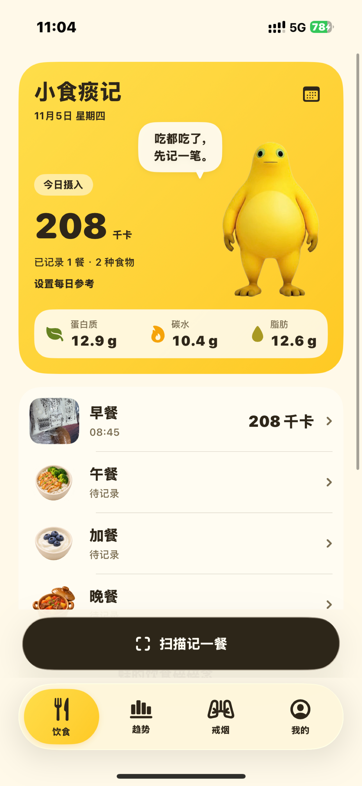
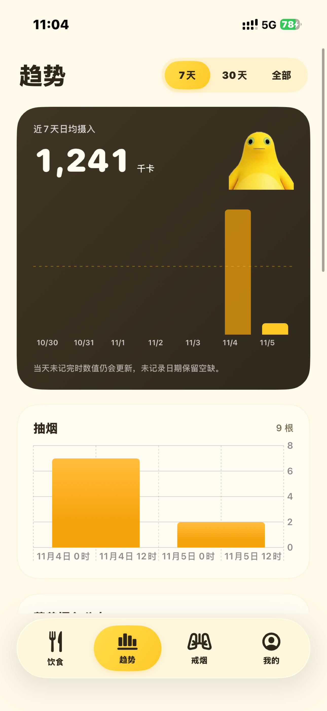
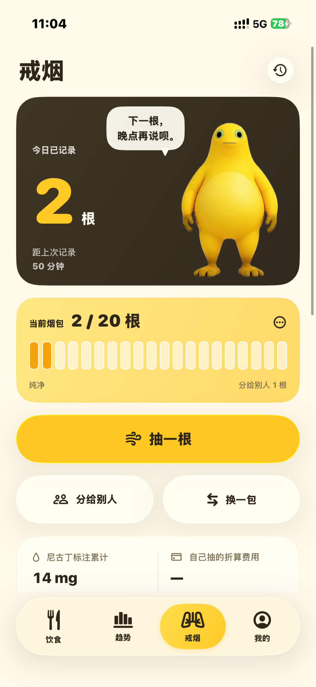
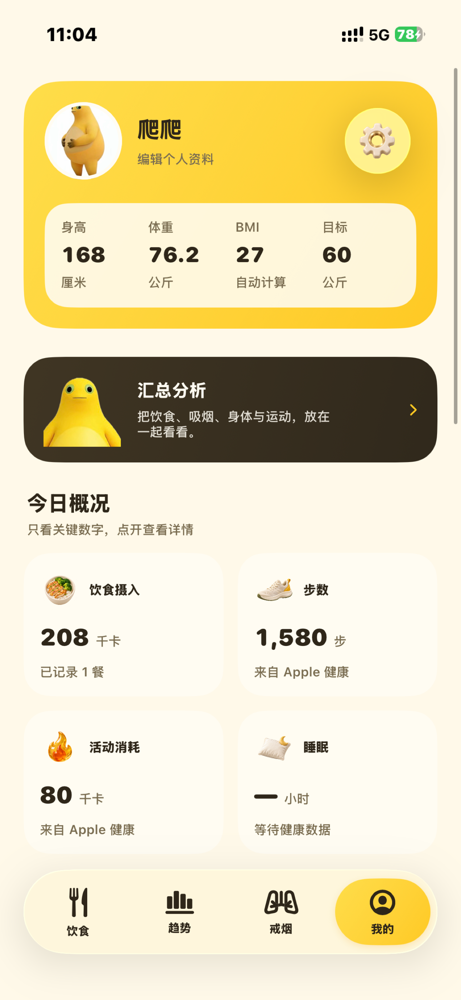
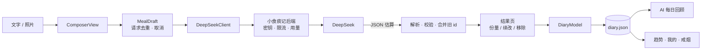

# 小食痰记 · Xiaoshitanji

<p align="center">
  
</p>

<p align="center">
  <b>用一句话、一张照片，记下你吃了什么。</b><br/>
  一个记录饮食、抽烟与身体的私人 iPhone 应用，AI 负责估算，你只负责吃。
</p>

<p align="center">
  
  
  
  
  
  
</p>

<p align="center">
  
  
  
  
  
</p>

> 名字取自《小石潭记》的谐音：**小食**是吃，**痰**是烟。一个 app，把「今天吃了什么、抽了几根、身体怎么样」都记下来。

---

## 目录

- [这是什么](#这是什么)
- [App 截图](#app-截图)
- [功能](#功能)
- [快速开始](#快速开始)
- [技术栈](#技术栈)
- [架构](#架构)
- [AI 是怎么工作的](#ai-是怎么工作的)
- [数据与隐私](#数据与隐私)
- [测试](#测试)
- [构建与签名](#构建与签名)
- [项目状态与路线图](#项目状态与路线图)
- [设计文档](#设计文档)
- [免责声明](#免责声明)
- [许可](#许可)

---

## 这是什么

「小食痰记」是一个面向日常记录的 iPhone 应用：你描述刚刚吃了什么（文字、相册照片或直接拍照），它调用 DeepSeek 估算食物条目、份量、热量与三大营养素，保存成一条餐次记录；每天结束时，它根据已保存的餐食生成一段 AI 回顾，并在 7/30 天趋势里展示摄入与评分变化。

除此之外，它还顺手管了两件事：

- **戒烟**：烟包库存、抽一根/分烟/余量校准、尼古丁与花费的按日汇总，烟盒也能拍照识别；
- **身体**：昵称、头像、身高、体重、BMI，以及只读的 Apple 健康数据（活动、睡眠、心率、有氧适能、耳机音量、体能训练、体重、身高）。

应用以本机 JSON 与 Photos 目录保存记录，支持可选的账号登录与云端同步；不再通过文件导入导出数据。

| 维度 | 说明 |
| --- | --- |
| 平台 | iPhone，竖屏，iOS 26+ |
| 语言 | 简体中文界面 |
| 视觉 | 浅色黄色主题 + 原生 Liquid Glass，奶蛙吉祥物 |
| 依赖 | 零第三方依赖，仅系统框架 |
| 网络 | AI 分析通过小食痰记后端转交 DeepSeek，可选云同步使用独立登录账号 |

作者：**爬爬 · Jay He** · [隐私政策](https://xiaoshitanji.papaclaoud.top/privacy) · [支持与反馈](https://xiaoshitanji.papaclaoud.top/support)

---

## App 截图

用户提供的 iPhone 真机截图，展示现有黄色奶蛙界面。点击可查看原图。

<table>
  <tr>
    <th>饮食记录</th>
    <th>摄入趋势</th>
    <th>戒烟记录</th>
    <th>个人健康</th>
  </tr>
  <tr>
    <td width="25%"><a href="docs/screenshots/01-diary.png"></a></td>
    <td width="25%"><a href="docs/screenshots/02-trends.png"></a></td>
    <td width="25%"><a href="docs/screenshots/03-smoking.png"></a></td>
    <td width="25%"><a href="docs/screenshots/04-profile.png"></a></td>
  </tr>
</table>

截图采集于 2026-11-05，部分按钮文案早于构建 37 的调整。截图展示已实现功能，后续规划中的首次引导、独立健身首页和经期跟踪尚未上线。素材说明见 [截图目录](docs/screenshots/README.md)。

---

## 功能

### 记一餐：输入 → 估算 → 修正 → 保存

- 支持**文字**、**相册照片**、**拍照**三种输入，文字可以补充图片（例如「这碗只吃了一半」）。
- 三种识别模式：**自动**（默认）、**碗装餐食**（结合碗型、装满程度、汤水与剩余量）、**营养标签**（见下一节）。
- 估算结果是可解释的：结果页会给出食物列表、自然份量、估算依据（summary）、假设（assumptions）与所用模型。
- 修正方式有四种，全部记录进 `adjustments` 以便回看：
  - 份量倍率：0.5× / 0.75× / 1.5× / 2×；
  - 自然语言续改：「米饭只吃了一半」「还有一碗汤」——AI 在现有餐食上增量修正，未提到的食物保持原样、原 id 回传；
  - 手改营养值：点进任一食物直接改写热量与三大营养素，标记为「手动填写」，不再依赖 AI；
  - 单项移除。
- 不依赖 AI 的记录方式：**手动填写**（名称、份量、克数、热量与蛋白质/碳水/脂肪，离线可用）与**一键复用**（把整餐存为「常吃组合」、搜索历史食物、复制最近吃过的一餐）。
- 保存到四餐次卡片（早/午/晚/加餐）。早餐默认 08:45、午餐 12:00、晚餐 20:00（取自个人常用时间范围的中间值），加餐取当前时刻；时间也可手动调整。
- 首页按本地日期汇总，可翻页、可开日历跳转；跨天或回到前台自动刷新到今天。
- 首页把「目标 − 已摄入」显示成**今日剩余**；目标优先由能量目标推导，没设置时退回通用设置里的参考热量。

### 营养标签

- 包装食品优先读营养表，保留原始计量基准：每 100 克 / 每 100 毫升 / 每份 / 每包。
- 能量单位支持 **kJ 与 kcal**，千焦按 `kJ ÷ 4.184` 换算成千卡，再按实际食用量等比缩放。
- 标签读取失败或看不清时不会瞎编：返回空标签并提示补拍，标签信息与份量估算在界面上分别标注。

### 每日 AI 回顾

- 「蛙的饮食碎碎念」：只依据**已保存**的餐食生成总结、最多 3 条亮点、最多 3 条建议，信息足够时给出 0–100 的参考评分。
- 少于 2 餐或信息不足时**不评分**（score 为 `null`），而不是硬凑一个分数。
- 修改、补记、删除当天餐食后，旧回顾自动失效；回顾会记录生成时的每日热量目标，目标变了就等待一份基于新目标的回顾，历史评分仍对应当时的目标。

### 趋势

- **7 天 / 30 天 / 全部**切换：摄入柱状图（带均值参考线）、体重折线、训练时长柱、抽烟柱、AI 评分折线与每日列表，同一时间轴。
- 某类没有数据就整块不显示，不摆空图；「全部」最多回看 365 天。
- 日均值只按**有记录的日子**计算，没有记录的那天是空缺而不是 0。

### 我的与 Apple 健康

- 首页按个人资料、汇总分析、四项今日概况、健康分类和常用工具组织。身体测量、活动与训练、心脏与体能、睡眠与听力分别进入二级页，指标详情与七日变化可继续展开。
- 「通用设置 → 关于小食痰记」提供作者署名、邮箱联系、用户协议、隐私说明、应用权限说明、个人信息清单与第三方 SDK / 服务说明；文档可在 App 内阅读。
- 默认餐次及个人页功能采用暖白黄色系透明拟物 PNG，晚餐使用双耳砂锅炖菜与锅盖造型。早餐、午餐和加餐使用现有素材，用户餐食照片优先展示。

- 顶部资料卡：头像、昵称、身高、当前体重、目标体重，自动算 BMI（身高需在 50–250 cm 之间才计算）。
- 体重历史：手动记录 + Apple 健康测量合并展示，取时间最新的一条，同一时间优先手动记录。
- Apple 健康**只读**：步数、活动能量、锻炼分钟、步行跑步距离、睡眠、心率与静息心率、心率变异性、有氧适能（最大摄氧量）、耳机音量暴露、体能训练（时长 / 消耗 / 距离）、体重、身高。授权后读取近 7 天趋势，保留无数据日期的空缺；读取失败时保留已有快照并给出提示。
- 体能训练直接从 Apple 健康读取，不用手动补录；手动训练记录仍保留，两者在分析里分开引用、不重复计数。
- 今日能量预算的训练消耗优先取健康里的体能训练；当天没有健康训练时才用手填训练的消耗，避免同一场训练算两次。
- 能量目标：BMR（Mifflin-St Jeor）× 活动系数估算维持热量，再按减脂/维持/增肌推导每日目标与蛋白质/碳水/脂肪；记录 2–4 周后可用体重趋势校准维持热量。没设置时仍可只填一个参考热量（界面显示为「参考」而非硬性目标）。
- 训练消耗计入当天：训练记录里填的消耗热量会加到当天目标上，卡片显示「训练 +N」；没填就不加，不猜。

### 戒烟记录

- 烟包管理：每包 20 根、记录开包时间与初始余量；「换一包」可从已识别保存的同款香烟里选择，也可切回未抽完的旧包，每包余量各自独立。
- 三类事件：**抽一根**（扣 1 根并记时间）、**分烟**（只扣库存）、**余量校准**（只修正库存）。事件可撤销，重放校验保证库存永远落在 0–20。
- 尼古丁按**每根标注值 × 自己抽的根数**累计（分烟不计入），未提供标注的单独显示「未知根数」。
- 花费按**每包价格 ÷ 20 × 根数**折算，CNY / VND / USD / HKD 分币种汇总，绝不跨币种相加。
- 烟盒 AI 识别：先拍正面读名称，再拍侧面读烟碱标注；只有照片能读到或你明确说出的价格与尼古丁才会采用，其余留空。可说「这包买了 30 元」「价格改成 25 元」补充，或「清空错误的尼古丁值」把它改回未知。

### 汇总分析

- 入口在「我的」资料卡下方的「汇总分析」，默认近 7 天，可切换近 30 天与全部记录；「全部」按月汇总。
- 一次综合四类数据：饮食摄入与营养分布、抽烟（自抽 / 分烟 / 尼古丁标注 / 费用）、身高体重 BMI 与测量变化、活动与恢复（步数、锻炼、睡眠、心率 / HRV、有氧适能、耳机音量、体能训练）。
- **发送前可预览**本地聚合出的数值，并选择是否包含 Apple 健康；确认后才请求 DeepSeek，缺失数据会明确标成「数据缺口」而不是编造。
- 报告包含综合观察、分类分析、优先行动与数据缺口，每个范围保留最近一份并随云同步上传；照片、头像、昵称与原始描述不会进入请求。

---

### 蛙的观察

- **自己找模式**：蛋白长期不足、抽烟集中在某个时段、记录断档、体重停滞、热量长期超标，全部在设备上算，开关可关；
- **自由追问**：问「晚饭怎么改」「为什么这周体重没动」，发送的是聚合数值（日期范围、餐数、日均营养、体重变化、步数、睡眠、心率、有氧适能与体能训练），不包含照片、原始输入和昵称；
- **回答带依据**：每条回答写明引用的是哪个日期范围、多少餐、哪些测量；记录不够时 AI 被要求直接说明缺口，而不是编数字；
- **旧回答会被标注**：记录变化后，之前回答标记「基于旧数据」，可以随时删除。

### 云端同步

- **自己的服务器**：默认连 `https://xiaoshitanji.papaclaoud.top`（作者自建，域名可在界面里改成你自己的），FastAPI + PostgreSQL，密码用 Argon2id 存哈希，令牌存本机钥匙串；
- **整份快照**：日记元数据作为一版快照上传，服务端支持 schema 1–5、保留最近 20 版，可列出和恢复历史版本；
- **独立照片**：餐食与烟盒照片先按 SHA-256 内容名上传，同一账号去重，快照只引用已上传照片。下载并校验全部照片后才合并本机记录，失败时可重试；
- **冲突自动合并**：首次同步及旧账号基线升级先拉取云端已有记录，初始空白资料继承云端档案，版本冲突最多重试 3 次。餐食、体重、抽烟、训练与计划按 id 取并集，同 id 保留本机值。恢复历史版本也使用该合并规则，本机删除的条目可能从云端重新出现；
- **大小护栏**：元数据快照上限 8 MiB，单张照片上限 5,000,000 字节，照片分批查询、逐张传输；
- **密码与账号**：用户名 3–32 位小写字母/数字/`_`/`.`/`-`，密码 8–128 位；同一账号可登录多台设备，改密码会吊销其他设备的令牌。

### 训练记录

- **两类都记**：力量按动作记组数、次数、重量，自动算容量；有氧记项目、时长、距离和平均心率；
- **体感可选**：1–10 的体感强度与消耗热量都能留空，不强迫填；
- **不替代 Apple 健康**：这里记训练细节（动作 / 组数 / 重量 / 距离），步数、活动热量和体能训练时长仍从健康读；同一天可以记多次；
- **训练计划**：把常练的一套存成计划（容量、次数、目标重量），下次点一下就能开练，组数自动展开成实际训练；
- **一处看全**：累计次数、总时长、力量容量和有氧公里数在「我的 → 训练记录」顶部。

### 小组件与灵动岛

- **今日摄入小组件**：主屏小/中尺寸显示今天的热量、剩余、三大营养素与餐数，半小时刷新一次，保存记录后立刻刷新；
- **灵动岛 / 锁屏实时活动**：在首页菜单里手动打开「灵动岛显示今日摄入」，锁屏显示摄入与剩余，灵动岛紧凑态只留数字；
- **数据怎么共享**：App 每次保存后把今日数字写进 App Group `group.com.jay.fooddiary` 的 `Library/widget-snapshot.json`，小组件只读这一份，不解析整份日记；
- **可关闭**：实时活动随时能关，小组件不想要就删掉，App 内不额外耗电。

### 快捷指令与 Siri

- **一句话记一餐**：「用 小食痰记 记一餐」说出吃了什么，App 打开时自动填进记录页；
- **只带文本**：快捷指令传的是一句话，不是照片；解析仍走正常的 AI 估算流程，可以先改再保存；
- **取一次就清**：待填的文字用过即删，不会每次启动重复弹出。

### 语音记一餐

- **说一句就行**：输入框旁的麦克风按钮把「牛奶喝了半盒」直接转成文字，转完还能改；
- **优先本地识别**：设备支持端上识别时不上传声音，不支持才走系统服务；
- **权限用完就放**：只在录音时占用麦克风，停止即释放，不后台常听。

### 每日提醒

- **四个提醒点**：早餐、午餐、晚餐、称重，时间自己调，逐个开关；
- **只在本机**：用系统的本地通知，不上传、不需要登录，关掉就真的不响；
- **首次开启才要权限**：没同意时静默跳过，不反复弹窗。

### 奶蛙的坚持

- **连续天数**：今天或昨天有记录才算「还在连」，断一天就归零，最长记录同时保留；
- **累计成果**：累计餐数、记录天数、戒烟天数，一眼看到这段时间攒下了什么；
- **11 个里程碑**：第一餐、连记 3/7/30 天、30/100/365 餐、体重十次、第一个常吃、七天/三十天没点烟；
- **抽烟累计**：自己抽了多少根、分出去多少根、按烟包单价折算花了多少钱，全部从事件流累加，能一条条对回去；
- **不制造焦虑**：没解锁的徽章只写「还没解锁」，不催、不排名、不上传。

### 本机备份

- **每天一份备份**：每天首次打开时把日记及餐食、烟盒照片写入自包含 JSON，后台执行。日备份和恢复前保护副本共保留 14 份，可在通用设置里关闭自动备份；
- **恢复由 App 自己完成**：备份目录损坏或写入中断时，App 会先把原文件与照片整体移到 `Backups/Recovery-*` 再启动，不需要用户手动找文件；
- **不再提供文件导入导出**：CSV 与 JSON 的导出、导入已移除，跨设备与换机统一走云同步，避免出现「文件比云端还旧」的两套数据。

## 快速开始

### 环境

| 需要 | 版本 |
| --- | --- |
| Xcode | 26（含 iOS 26 SDK） |
| Swift | 6.0（语言模式），SwiftPM 6.2 |
| 测试环境 | macOS 15+（`swift test` 只跑纯逻辑，不需要模拟器） |
| 真机 | iOS 26 或更新，启用开发者模式 |

### 运行

1. 打开 `FoodDiary.xcodeproj`。
2. 选择 `FoodDiary` scheme。
3. 在 **Signing & Capabilities** 里换成你自己的开发团队（仓库里填的是作者团队，其他人直接跑会签名失败）。
4. 连接并解锁 iPhone，选择设备后运行。

命令行构建：

```sh
xcodebuild -project FoodDiary.xcodeproj -scheme FoodDiary \
  -configuration Debug -destination 'generic/platform=iOS' \
  -derivedDataPath work/DerivedData build
```

> `work/` 是本地构建与验证目录，已被 Git 忽略。

### 使用 AI 分析

AI 功能免费提供，无需填写 API Key，也无需先创建同步账号。打开「饮食」点「扫描记一餐」，或选择餐次后输入描述即可。

App 请求 `https://xiaoshitanji.papaclaoud.top/v1/ai/completions`，由服务器使用私密配置中的 DeepSeek 密钥转发。模型、4096 输出令牌上限和调用费用统一由后端管理。饮食与烟盒识别发送相关文字及压缩照片，汇总分析经确认后发送聚合数值。后端默认每个网络每分钟 10 次、每天 60 次，全服务每天 1,000 次，同时处理 4 个请求，日额度按 UTC 零点更新（北京时间 08:00）。App 请求超时为 120 秒，上游调用超时为 80 秒。

参考文档：

- [DeepSeek 首次调用](https://api-docs.deepseek.com/)
- [图片输入（vision）](https://api-docs.deepseek.com/guides/vision)
- [JSON Output](https://api-docs.deepseek.com/guides/json_mode)

### 跑测试

```sh
swift test
```

在 Mac 上直接运行，不需要模拟器，也不需要签名。

---

## 技术栈

| 层 | 选型 |
| --- | --- |
| 界面 | SwiftUI（iOS 26）、Liquid Glass、Observation（`@Observable`） |
| 数据 | `Codable` + JSON、`FileManager` 原子写入 |
| 凭据 | AI 密钥保存在后端私密配置，云同步会话使用 iPhone Keychain |
| AI | DeepSeek Chat Completions、JSON Output、vision |
| 健康 | HealthKit（只读） |
| 图像 | ImageIO（缩图 + 重编码）、UIImagePickerController |
| 系统集成 | WidgetKit · ActivityKit · App Intents · UserNotifications · Speech |
| 测试 | Swift Testing（`swift-testing`） |

---

## 架构

```text
FoodDiary/                      SwiftUI 界面、Keychain、相机与图片处理
├── App/                        @main、Tab 容器、全局 DiaryModel 与视觉主题
├── Features/                   饮食 / 趋势 / 戒烟 / 我的 各页面与组件
├── Services/                   HealthKit 读取、照片处理、Keychain
└── Assets.xcassets/            奶蛙素材与餐次图标

FoodDiaryWidgets/               小组件扩展：今日摄入 + 灵动岛实时活动
Shared/                         App 与扩展共用：小组件快照、实时活动属性

FoodDiary.xcodeproj/            iPhone 原生工程（自动签名、HealthKit + App Group）
Sources/NutritionCore/          纯逻辑 Swift Package，无 UIKit 依赖
Tests/NutritionCoreTests/       Swift Testing 回归测试与可选演示数据工具
docs/superpowers/               设计规格（specs）与实施计划（plans）
work/                           本地构建与验证记录（Git 忽略）
```

`NutritionCore` 是刻意的分离：模型、校验、文件读写、DeepSeek 请求与解析全部不依赖 UI，所以能在 macOS 上用 `swift test` 秒级跑完，也方便以后搬到其他 Apple 平台。

### 分层职责

- **NutritionCore**：`DiaryDocument`（单一事实来源）、`MealRecord`/`FoodItem`/`Nutrition`、`DiaryStore`（原子读写）、`DeepSeekClient`（请求构造 + 响应解析）、`NutritionLabel`、`DietReview`、`SmokingDiary`、`HealthProfile`。
- **DiaryModel**：`@MainActor @Observable`，所有写操作的唯一入口；「拷贝 → 修改 → 保存 → 替换」模式，写失败不影响内存里的旧数据。
- **视图层**：只读模型、不碰网络。`MealDraft` 专门管理一次记录的草稿状态（忙碌、脏检查、请求去重与取消）。

### 数据流



---

## AI 是怎么工作的

一次分析只发一个请求，四类用途共用同一套请求构造：

| 用途 | 请求字段 | 约束 |
| --- | --- | --- |
| 估算 | 文字 + 可选图片 | ≤10,000 字、图片 ≤5 MB，空输入直接报错 |
| 续改 | 当前食物 + 已应用改动 + 新指令 | 指令 ≤4,000 字，未提到的食物原样保留并回传原 id |
| 回顾 | 已保存的餐食与营养 + 可选热量目标 | 最多 3 亮点、3 建议，评分可空 |
| 追问 | 聚合快照 JSON + 一个问题 | 问题 ≤200 字、快照 ≤100 KB、回复 ≤3,000 字，必须引用快照里的数字 |

共同点：

- `response_format: {"type":"json_object"}`、`temperature: 0.2`、`max_tokens: 4096`、`thinking: disabled`，保证输出可解析且不浪费 token；
- 只接受 `finish_reason == "stop"` 的响应，截断或异常一律按错误处理；
- 错误统一映射成中文文案（401 未授权、402 余额不足、429 限流、400/422 参数、5xx 服务端），用户看得到原因；
- 图片在设备端缩到最长边 1920 px、JPEG 0.78 重编码，**剥离位置与相机元数据**后才发送。

解析层的几个关键约定：

- 食物按 **id → 唯一同名** 匹配旧条目，复用 id 与备注，避免每次修正都产生重复食物；
- 营养标签默认**继承旧标签**并按新克数等比缩放 `consumedAmount`；只有 AI 明确判定「换了产品」或「旧标签不适用」时才允许丢弃（`discardNutritionLabel`）；
- 返回的食物列表为空、营养值非法（负数/NaN）都会被拒绝，而不是保存一个坏数据。

---

## 数据与隐私

记录元数据保存在 App Documents 的 `FoodDiary/diary.json`，照片放在 `FoodDiary/Photos/`。新照片采用 `photo-<SHA256>.jpg` 内容名，替换图片会生成新文件，历史快照保留原图。旧 `record-<id>.jpg`、`pack-<id>.jpg` 引用仍可读取，内嵌 base64 会自动迁出。

| 字段 | 内容 |
| --- | --- |
| `schemaVersion` | 当前为 5（v1–v4 文件可直接读取并自动升级；高版本文件不会被旧版本覆盖） |
| `records` | 餐次、日期、食物、原始输入、照片文件名、修正历史 |
| `reviews` | 每日 AI 回顾与生成时的热量目标 |
| `profile` | 昵称、头像、身高、目标体重 |
| `weights` | 手动体重历史 |
| `smoking` | 烟包、抽烟/分烟/校准事件 |
| `wellnessReviews` | 每个范围最新的汇总报告、生成时间与数据快照 |
| `observations` | 最近 30 条追问回答：问题、回答、依据、范围与生成时的聚合指纹 |
| `workouts` | 训练记录：力量（动作/组数/次数/重量）与有氧（项目/距离/心率/时长/体感） |
| `plans` | 训练计划：名称、时长、动作组数次数与目标重量、有氧项目；最多 20 条，按最近使用淘汰 |
| `templates` | 常吃组合（整餐食物、使用次数、最近使用时间） |
| `energy` | 能量目标设置（性别、出生年、活动水平、减脂/维持/增肌、每周速度、校准值） |

本机备份写在 `FoodDiary/Backups/`，完整 JSON 内嵌餐食与烟盒照片，可脱离原 Photos 目录恢复。原始 `diary.json` 需与 Photos 一起保存；旧备份缺失的原照片需从原设备补回。

同步令牌与账号信息**不在**这个文件里，存在 Keychain（服务 `com.jay.fooddiary.sync`）。

写入策略：

- 保存前先 `validate`，再**读一遍旧文件**（确认不是损坏或更高版本的文件）才落盘，防止覆盖保护被绕过；
- 原子写入 + `completeFileProtectionUntilFirstUserAuthentication`；
- 编辑或删除当天餐食会让对应的 AI 回顾失效，保存回顾时校验「记录数快照」，防止用旧数据写报告。

隐私：

- 默认不需要账号，数据只在本机；可选登录作者自建的同步服务，整份日记以快照形式存到你的账号下（服务端不记录 AI 请求内容）；AI 请求在用户发起分析或烟盒扫描识别时经后端转交 DeepSeek；
- AI 密钥只存放在服务器私密配置中，App 的请求无需提供模型或密钥；
- 记录只在本机与自己配置的同步服务器之间流动，没有文件导出通道；App 目录仍可在 iPhone「文件」App 里查看；
- Apple 健康数据只读。汇总分析可选择纳入所选期间的活动与身体测量，生成前确认后才将汇总数值经后端转交 DeepSeek。历史照片、头像、昵称和原始描述不进入该请求。报告及这次汇总值保存在本机，并随用户主动启用的云同步传输。

---

## 测试

```sh
swift test
# 2026-11-05：210 tests in 28 suites，含 1 项默认跳过的演示工具
Tests/AppRegression/run-ai-consent.sh
# 首次明确授权、拒绝、撤回、任务取消与并发等待，共 5 项 PASS
Tests/AppRegression/run-sync-model.sh
# 恢复合并、冲突重试、旧账号基线迁移及账号删除失败保护
python3 Tests/AppRegression/check-profile-artwork.py
# 11 项健康指标分类、15 个图片资源及入口标识核验
cd server && api/.venv/bin/python -m pytest -q
# 2026-11-05：63 passed
```

Swift 测试跑在 macOS 上，演示数据生成工具默认跳过。下表列出主要测试组，照片传输测试通过 URLSession 实际客户端验证请求顺序与失败保护。

| Suite | 覆盖内容 |
| --- | --- |
| `DiaryTests` | 份量缩放（150 g 米饭 → 174 kcal）、非法值/重复食物拒绝、保存重开编辑删除、损坏与高版本文档不可覆盖、本地日历分组、草稿预填时间 |
| `CoachTests` | 续改请求上下文、份量解析与 `adjustments` 累积、回顾请求营养与可选目标、空记录报错、单餐不评分 |
| `DeepSeekTests` | 请求构造、`finish_reason` 校验、错误映射、空响应拒绝 |
| `ManagedAIServiceTests` | 受管后端请求、无需客户端密钥、服务错误与限额提示 |
| `NutritionLabelTests` | 三种基准（g/mL/份/包）、kJ→kcal、按食用量缩放、非法基准拒绝 |
| `MealTimeTests` | 各餐次预设时间与取中点规则 |
| `HealthProfileTests` | BMI 边界、资料校验、体重来源与同日选择、旧格式兼容 |
| `RedesignTests` | 输入变更使旧估算失效、续改保留标签基准、模式指令透传 |
| `SmokingTests` | 烟包快照、库存重放校验、多币种分离、未知尼古丁与价格、AI 识别字段合并 |
| `RecordLoopTests` | 手动录入解析与校验、手改营养值、餐内增改、常吃组合增删与上限、最近食物搜索、v1→v2 兼容与版本写盘 |
| `ObservationTests` | 上下文聚合与缺口、证据行、指纹稳定性、回答校验与 30 条上限、五种本地模式的触发与不触发、追问请求与解析 |
| `EnergyTests` | BMR 公式、活动系数、减脂/增肌缺口、安全下限、宏量分配、体重趋势校准、缺失体重与非法参数、旧文档兼容、训练消耗计入当日收支 |
| `WellnessTests` | 范围与预设餐次、缺失与零、分烟排除、各币种费用、测量来源、请求字段、报告格式与旧文件兼容 |
| `WorkoutPlanTests` | 计划生成训练的动作展开与时长、校验、从旧训练建计划、20 条上限与最近使用、从计划开练、v4→v5 兼容 |
| `SmokingStatsTests` | 按根数累计、分烟不计入自己抽、按烟包单价折算、多币种分开、未填价格 |
| `WorkoutTests` | 力量容量与组数、动作/时长/次数校验、有氧距离心率、训练增删与当天筛选、v2→v3 兼容 |
| `ReminderTests` | 默认开关与时间、非法时间不排期、下一次提醒跨天、全部关闭、时间回填 |
| `MilestoneTests` | 连续/最长天数、断档归零、昨天宽限、里程碑阈值解锁、戒烟天数与空文档 |
| `BackupTests` | 同一天只写一份、按保留数量裁剪、还原往返、坏文件拒绝 |
| `CloudSyncTests` | 服务器地址规范化、账号密码本地校验、请求构造与 Bearer 头、登录/状态/快照/上传/版本解析、409 与 413 分支、8 MB 上限、冲突合并的并集与本机优先、吸烟合并 |
| `SyncIntegrityTests` | 训练与计划合并、照片内容名与去重、完整备份、旧数字日期、同日旧备份升级、恢复点保留、损坏原文件保护 |
| `WellnessCompatibilityTests` | 旧报告与嵌套时间线缺少新增指标时读取、保存、备份、云端快照兼容，新指标往返与损坏数据拒绝 |
| `CloudPhotoSyncTests` | 先照片后快照、重试去重、上传失败阻止快照发布、下载哈希校验与重试、拒绝无关照片清单 |

界面布局、相机、键盘、健康授权和真实联网调用依赖真机，不在自动化测试范围内。

---

## 构建与签名

| 配置 | 值 |
| --- | --- |
| Bundle Identifier | `com.jay.fooddiary` |
| Deployment Target | iOS 26.0 |
| Swift | 6.0（`SWIFT_VERSION`），包清单 tools 6.2 |
| 签名 | 自动签名（仓库内为作者团队，使用前请替换） |
| Capabilities | HealthKit、App Group（`FoodDiary/FoodDiary.entitlements`） |
| 版本 | 1.0.1，构建号 37，App 与小组件一致 |

真机测试、TestFlight 上传与正式发布均使用当前分支最新源码构建。执行前核对提交、工作区改动及主程序和小组件版本，安装后回读设备上的版本号。上传与发布按用户当次指令执行。

2026-11-05 已验证 Debug / Release iPhone 签名构建通过，最终日志无编译警告。主程序与内嵌小组件均通过严格签名校验，App Group 与主程序 HealthKit 权限有效。使用 Apple 健康需要在真机上完成授权。

---

## 项目状态与路线图

**当前源码版本 1.0.1（37）**。构建 35 将 AI 调用迁至后端，用户无需填写密钥；构建 36 增加首次 AI 数据明确授权和撤回入口；构建 37 增加关于页及五类说明文档，并补齐 HealthKit 要求的用途说明，应用实际仍只请求读取健康数据。此前的旧记录兼容、独立照片同步、完整备份恢复、训练与计划合并、个人主页分类和晚餐独立图标均保留。

2026-11-05，用户已完成真机测试并确认已提交 Apple 审核。当前优先完成上架；下列后续需求仅登记待办，不进入本次审核包。审核与正式上架结果以 App Store Connect 为准。

| 状态 | 事项 |
| --- | --- |
| ✅ 已实现 | 手动录入营养（离线可用）、AI 结果手改营养值、常吃组合、历史食物搜索、复制最近吃过的一餐 |
| ✅ 已实现 | 能量目标：BMR × 活动系数 → 维持热量 → 每日目标与三大宏量，支持减脂/维持/增肌与体重趋势校准；首页显示今日剩余 |
| ✅ 已实现 | 「蛙的观察」：五种本地模式识别（蛋白、抽烟时段、断档、体重停滞、热量超标）+ 只发聚合数值的追问，回答标注依据与「基于旧数据」 |
| ✅ 已实现 | 「我的」跨饮食、抽烟、运动与身体的 AI 汇总分析。默认近7天，可切换30天和全部记录，预览并确认后发送，按范围保留最新报告 |
| ✅ 已实现 | 健康全景：睡眠、心率 / 静息心率 / HRV、有氧适能、耳机音量与 Apple 健康体能训练接入趋势与 AI 分析，缺失数据明确标为缺口 |
| ✅ 已核验 | 云端同步与自包含备份恢复；2026-11-05 Swift 套件共 210 项（含 1 项默认跳过），AI 授权与同步编排回归通过，后端 63 项通过 |
| ✅ 线上验证 | 2026-11-05 已部署兼容修复，公共 HTTPS 照片往返、账号隔离、并发冲突、去重与历史恢复通过，临时账号已清理 |
| ✅ 用户真机测试 | 1.0.1（37）已安装并回读版本，用户报告测试完成。此项为用户验收记录，不表示自动化覆盖所有界面 |
| ✅ 历史真机记录核验 | 1.0.1（32）已安装。iPhone Use 实查昨天 5 餐、两包香烟及历史记录恢复显示，今日新增早餐正常保存。原记录与 5 张照片已逐项核对，完整相机、键盘与两设备交互验收继续由用户测试 |
| ✅ 已实现 | 七条主线的首版能力见 [`docs/backlog.md`](docs/backlog.md) 的进度，扩展需求保留在后续规划表 |
| 🧪 TestFlight 核验 | 2026-11-05，1.0.1（37）上传成功，Apple 处理为 VALID，并已关联内部测试组；不代表 App Store 审核通过 |
| ⏳ 后续待完成 | 首次引导、可不透露的性别与年龄、个人目标、吸烟模块开关、统一 AI 个性化与独立健身入口，建议排入 1.1.0 |
| ⏳ 后续待完成 | 经期记录、日历、提醒、独立 AI / 同步选择及跨模块分析，建议排入 1.2.0 |

### 下一阶段：个性化、健身与经期跟踪（未开发）

| 建议阶段 | 计划内容 | 关键验收 |
| --- | --- | --- |
| 1.1.0 | 三步可跳过引导、年龄与性别可不透露、个人目标、独立模块开关、统一 AI 上下文、健身放在趋势后面 | 关闭吸烟后所有新分析均不含历史吸烟数据；无资料不猜测；训练与消耗不重复计算 |
| 1.2.0 | 经期日历、实际记录与预计日期、可选提醒、独立隐私选择和综合建议 | 未开启不采集；AI 与云同步分别选择；拒绝后仍可本机记录 |

性别只用于初始推荐，吸烟与经期可独立开启，女性用户也能同时使用两者。关闭模块保留历史，删除需单独确认。食品营养事实不随个人目标改变，个性化用于建议。版本号是排期建议，尚未实施或发布。

详细规则见 [后续设计方案](docs/superpowers/specs/2026-11-05-personalization-fitness-cycle.md)，可勾选步骤见 [实施待办](docs/superpowers/plans/2026-11-05-personalization-fitness-cycle.md)，项目总清单见 [backlog](docs/backlog.md)。真机设计验收记录 `design-qa.md` 保留在本地，不随仓库发布。

---

## 设计文档

开发过程按「先写 spec，再拆 plan，最后实现」推进，文档都在 `docs/superpowers/`：

| 文档 | 内容 |
| --- | --- |
| [`specs/2026-11-04-food-diary-mvp.md`](docs/superpowers/specs/2026-11-04-food-diary-mvp.md) | 首版 MVP：本地 JSON、餐次记录 |
| [`specs/2026-11-04-ai-first-redesign.md`](docs/superpowers/specs/2026-11-04-ai-first-redesign.md) | 以 AI 估算为中心的重构 |
| [`specs/2026-11-04-labels-and-smoking.md`](docs/superpowers/specs/2026-11-04-labels-and-smoking.md) | 营养标签与戒烟记录 |
| [`specs/2026-11-04-personal-health.md`](docs/superpowers/specs/2026-11-04-personal-health.md) | 个人档案、体重、Apple 健康 |
| [`specs/2026-11-04-yellow-ui.md`](docs/superpowers/specs/2026-11-04-yellow-ui.md) | 黄色奶蛙视觉与自定义 TabBar |
| [`specs/2026-11-05-personalization-fitness-cycle.md`](docs/superpowers/specs/2026-11-05-personalization-fitness-cycle.md) | 后续待完成：首次引导、个人目标、动态模块、AI 个性化、健身与经期跟踪 |
| [`plans/2026-11-05-personalization-fitness-cycle.md`](docs/superpowers/plans/2026-11-05-personalization-fitness-cycle.md) | 上述方案的分阶段任务、依赖、验收与发版门槛，全部待完成 |

对应实施计划在 `docs/superpowers/plans/`，任务勾选状态代表真实进度。

---

## 免责声明

- 热量与营养是 **AI 估算**，不是称重结果，仅供参考，不构成医疗或营养建议。
- 香烟的尼古丁标注通常是机器测定的**烟气释放量**，人体实际吸收因抽吸方式而异；价格按每包价除以 20 折算。
- 应用不提供任何医学诊断。

---

## 许可

仓库公开用于展示与备份，**未附开源许可证**，默认保留所有权利。如需复用其中的代码，请先联系作者。
