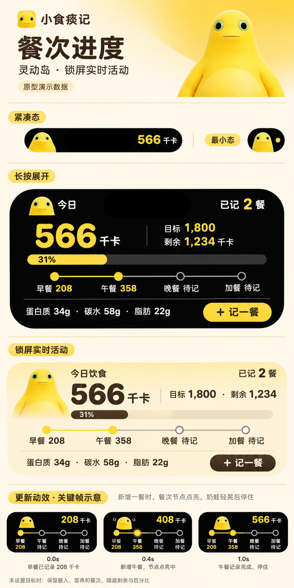

# 奶蛙灵动岛与锁屏实时活动

2026-11-05，用户选定第三套「餐次进度」，要求先完成代码，不做测试、构建和安装。

本图为设计原型，含演示数据及动画关键帧，不能作为实际 iPhone 截图或动画验收。1,800 千卡不会写成用户默认目标。

## 已编写的行为

- 紧凑态：奶蛙与当日摄入；空间不足时优先数字。最小态：奶蛙与状态点。
- 展开态：奶蛙与餐数放在相机两侧，数据放在底部区域。摄入、目标、剩余 / 超出、进度、四餐节点、三大营养与记餐入口。
- 锁屏：奶油黄底、奶蛙、同一套数据与餐次信息，内容高度 160 pt；展开内容区为 112 pt，最终系统边距待真机核对。
- 奶蛙复用扩展已有的 WidgetMilkFrogPeek 图片。饮食事实改变时以 0.65 秒弹性进入过渡产生轻晃，数字 / 进度 / 餐次短暂过渡；不用计时器或循环刷新。实际表现由 WidgetKit 决定，尚未真机确认。
- 息屏降低亮度或启用减少动态效果时使用静态显示。
- 「记一餐」打开 xiaoshitanji://meal/new，复用已有的直接 ComposerView 路由与草稿保护；其他区域打开今日。

## 数据

ContentState 增加可选营养值、四餐明细和时区，使用 WidgetSnapshotBuilder 的今日统计。主程序保存后更新，活动启动 / 刷新均使用与今日页面及桌面组件一致的目标口径。重启 App 时恢复已开启活动的引用，不自动创建活动。

旧活动缺少新字段时仍可解码：营养显示 —，餐次显示更新提示。没有目标时隐藏百分比和进度，不虚构剩余。零记录的各餐显示待记；节点按真实餐次独立点亮，跳过早餐不会替用户点亮早餐。

新发布的状态在本地零点标记过期；日期或时区不匹配时不再显示旧数字为今日摄入。活动生命周期仍由系统管理，过期提示不会自动创建下一天的活动。

## 本轮交付边界

仅代码与文档。没有执行测试、Swift 编译、Xcode 构建、预览渲染、设备操作、上传或提审，也没有更新本机最新版安装包指针。工程版本号沿用当前设置；下一次生成安装包前再确定递增构建号。

后续需核对：SwiftUI / ActivityKit 编译；旧状态解码；无目标和跨日；跳餐 / 修改 / 删除记录；iPhone 展开区总高度和相机避让；长数字；减少动态效果与息屏；记餐冷启动 / 已有草稿；快速连续保存后的更新顺序。
