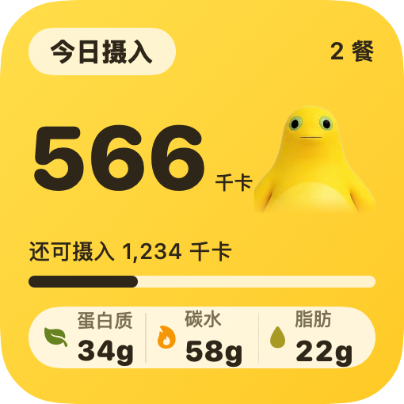
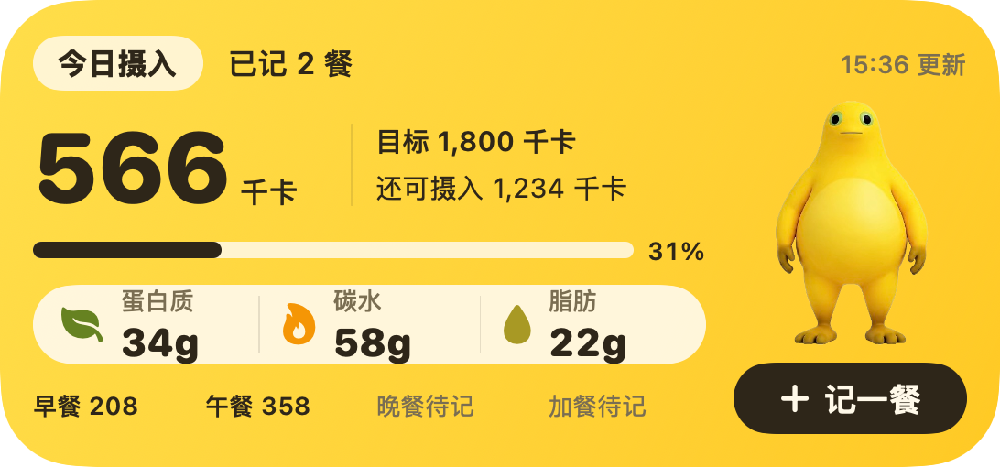

# 奶蛙今日摄入组件

2026-11-05。用户已确认两种尺寸的原型，并要求中号“记一餐”直接进入餐食编辑页。

| 尺寸 | 已确认原型 | 原生 SwiftUI 实现排版核对 |
| --- | --- | --- |
| 小号 | [small-prototype.png](small-prototype.png) | [small-implemented.png](small-implemented.png)，170 × 170 pt |
| 中号 | [medium-prototype.png](medium-prototype.png) | [medium-implemented.png](medium-implemented.png)，364 × 170 pt |

  
  

实现图由同一份 IntakeWidgetContent 使用 macOS ImageRenderer 离屏生成，数值为演示。组件安装后使用本机记录；图示的 1,800 千卡不会成为用户默认目标。奶蛙使用项目原有 PNG，扩展中独立打包，标题、数字、进度和入口为原生 SwiftUI。

## 排版核对

已查看 170 / 158 pt 小号、364 × 170 / 338 × 158 pt 中号，以及目标已设、目标未设、旧快照缺少餐次、今日待更新、零记录和长数字的渲染。中号的数字 / 单位使用同一行富文本，避免目标信息将数字挤成省略号。奶蛙和文字分别占位，底部摘要与主入口保留边距。

实际大小依据 WidgetKit 提供的空间布局。macOS 的字体与控制显示可能与 iPhone 略有不同；这些图片只证明静态布局已核对，不证明手机桌面刷新、URL 投递、冷启动或草稿衔接已通过。

## 数据与跳转

- 小号：摄入、餐数、剩余、目标进度、蛋白质 / 碳水 / 脂肪。
- 中号：增加目标值、更新时间、四餐明细与“记一餐”。
- 按钮打开 `xiaoshitanji://meal/new`，Root 切到饮食页，直接展示现有 ComposerView；组件其他区域打开 `xiaoshitanji://today`。
- 现有表单或草稿不被替换，正常关闭后按首次点击时刻创建草稿；组件草稿打开期间重复点击不会再排队。不会自动发 AI 请求或保存空记录。
- 无目标保持未知；跨天或时区不匹配的旧数据不再显示成今天的数据。旧 JSON 没有分餐字段时显示更新提示，不把未知餐次当作未记。

## 验证范围

纯逻辑与实际 DiaryModel 发布路径由 [组件回归](../../../Tests/AppRegression/WidgetRegression.swift) 覆盖。iPhone 页面、桌面刷新和按钮交互由用户自行测试；不使用模拟器。本次功能属于下一测试版本 1.0.2（38），不上传或替换当前 1.0.1（37）审核包。

完整约束见 [规格](../../superpowers/specs/2026-11-05-widget-redesign.md)，执行任务见 [实施计划](../../superpowers/plans/2026-11-05-widget-redesign.md)。
